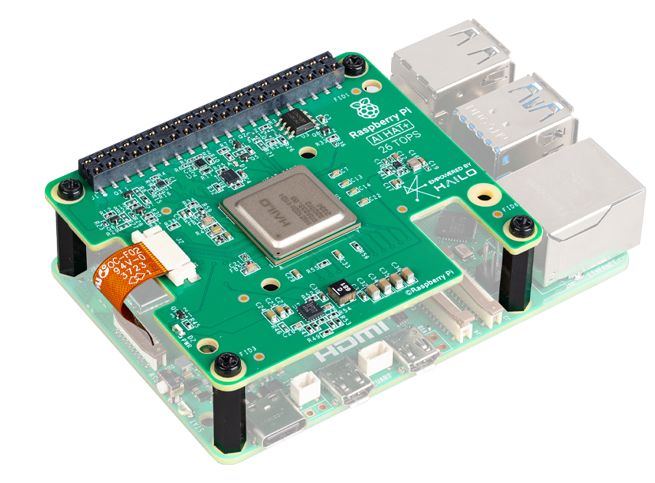
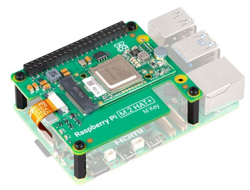

.. include:: /index.rst
   :start-after: start_hello_message
   :end-before: end_hello_message

FAQ
============

Schnelle Fehlerbehebung
-------------------------

* Einschalttaste funktioniert nicht → :ref:`faq_power_button_not_work_max`
* OLED-Bildschirm funktioniert nicht → :ref:`faq_oled_max`
* RGB-LEDs funktionieren nicht → :ref:`faq_rgb_max`
* GPIO-Lüfter funktionieren nicht → :ref:`faq_gpio_fans_max`
* CPU-Lüfter dreht sich nicht → :ref:`faq_pwm_fan_max`
* Dashboard zeigt keine Daten an → :ref:`faq_dashboard_max`
* NVMe-SSD wird nicht erkannt → :ref:`faq_nvme_max`
* NVMe-SSD erkannt, verursacht aber Systemneustart → :ref:`faq_nvme_link_down_max`

1. Hardware
-------------

.. _com_os_max:

Kompatible Systeme
^^^^^^^^^^^^^^^^^^^^

.. include:: ../pironman5/faq.rst
   :start-after: start_faq_com_os
   :end-before: end_faq_com_os

Einschalttaste
^^^^^^^^^^^^^^^^

.. |link_safe_shutdown| replace:: :ref:`safe_shutdown_max`

.. include:: ../pironman5/faq.rst
   :start-after: start_faq_power_button
   :end-before: end_faq_power_button

.. _faq_power_button_not_work_max:

Einschalttaste funktioniert nicht?
^^^^^^^^^^^^^^^^^^^^^^^^^^^^^^^^^^^^

.. include:: ../pironman5/faq.rst
   :start-after: start_faq_power_button_not_work
   :end-before: end_faq_power_button_not_work

Kupferrohrenden am Tower-Kühler
^^^^^^^^^^^^^^^^^^^^^^^^^^^^^^^^^

.. include:: ../pironman5/faq.rst
   :start-after: start_faq_copper_pipe_ends
   :end-before: end_faq_copper_pipe_ends

Raspberry Pi AI HAT+
^^^^^^^^^^^^^^^^^^^^^^

Der Raspberry Pi AI HAT+ ist nicht mit dem Pironman 5 MAX kompatibel.

Das Raspberry Pi AI Kit kombiniert den Raspberry Pi M.2 HAT+ und das Hailo-KI-Beschleunigermodul.

Sie können das Hailo-KI-Beschleunigermodul vom Raspberry Pi AI Kit abnehmen und direkt in das NVMe PIP-Modul des Pironman 5 MAX einsetzen.

Kann ich die Vibrationsschalterfunktion des Pironman5 Max verwenden?
^^^^^^^^^^^^^^^^^^^^^^^^^^^^^^^^^^^^^^^^^^^^^^^^^^^^^^^^^^^^^^^^^^^^^^

Ab v1.3.6 wird das Aufwecken des OLED über die Einschalttaste realisiert. Sie müssen die Jumperbrücke des Vibrationsschalters entfernen, um die GPIO-Pins des Raspberry Pi nicht zu belegen und mögliche Konflikte zu vermeiden. Bitte prüfen Sie, ob diese Jumperbrücke vorhanden ist; falls nicht, ignorieren Sie diesen Hinweis.

.. image:: /pironman5_max/img/remove_vib_jumper.jpg

2. Kühlung und Lüfter
-----------------------

.. _faq_pwm_fan_max:

CPU-Lüfter funktioniert nicht?
^^^^^^^^^^^^^^^^^^^^^^^^^^^^^^^^

.. include:: ../pironman5/faq.rst
   :start-after: start_faq_pwm_fan
   :end-before: end_faq_pwm_fan

.. _faq_gpio_fans_max:

GPIO-Lüfter funktionieren nicht?
^^^^^^^^^^^^^^^^^^^^^^^^^^^^^^^^^^

.. include:: ../pironman5/faq.rst
   :start-after: start_faq_gpio_fans
   :end-before: end_faq_gpio_fans

3. OLED und RGB
-----------------

.. _faq_oled_max:

OLED-Bildschirm funktioniert nicht?
^^^^^^^^^^^^^^^^^^^^^^^^^^^^^^^^^^^^^

.. |link_compatible_systems| replace:: :ref:`com_os_max`
.. |link_set_up_pironman5| replace:: :ref:`set_up_pironman5_max`

.. include:: ../pironman5/faq.rst
   :start-after: start_faq_oled
   :end-before: end_faq_oled

.. _faq_rgb_max:

RGB-LEDs funktionieren nicht?
^^^^^^^^^^^^^^^^^^^^^^^^^^^^^^^

.. include:: ../pironman5/faq.rst
   :start-after: start_faq_rgb
   :end-before: end_faq_rgb

.. _faq_customize_oled_max:

Wie passe ich den OLED-Bildschirm an?
^^^^^^^^^^^^^^^^^^^^^^^^^^^^^^^^^^^^^^^

.. include:: ../pironman5/faq.rst
   :start-after: start_faq_customize_oled
   :end-before: end_faq_customize_oled

4. Dashboard und Software
---------------------------

.. _faq_dashboard_max:

Dashboard zeigt keine Daten an
^^^^^^^^^^^^^^^^^^^^^^^^^^^^^^^^

.. include:: ../pironman5/faq.rst
   :start-after: start_faq_dashboard
   :end-before: end_faq_dashboard

Wie deaktiviere ich das Web-Dashboard?
^^^^^^^^^^^^^^^^^^^^^^^^^^^^^^^^^^^^^^^^

.. |link_view_control_dashboard| replace:: :ref:`view_control_dashboard`

.. include:: ../pironman5/faq.rst
   :start-after: start_faq_disable_dashboard
   :end-before: end_faq_disable_dashboard

Wie deinstalliere und reinstalliere ich die Pironman 5 Software?
^^^^^^^^^^^^^^^^^^^^^^^^^^^^^^^^^^^^^^^^^^^^^^^^^^^^^^^^^^^^^^^^^^

.. include:: ../pironman5/faq.rst
   :start-after: start_faq_reinstall_pironman5
   :end-before: end_faq_reinstall_pironman5

Wie steuere ich Komponenten mit dem ``pironman5``-Befehl?
^^^^^^^^^^^^^^^^^^^^^^^^^^^^^^^^^^^^^^^^^^^^^^^^^^^^^^^^^^^

.. |link_view_control_commands| replace:: :ref:`max_view_control_commands`

.. include:: ../pironman5/faq.rst
   :start-after: start_faq_pironman5_command
   :end-before: end_faq_pironman5_command

5. Boot und Speicher
----------------------

Wenn ich OMV einrichte, kann ich dann trotzdem die Funktionen des Pironman5 nutzen?
^^^^^^^^^^^^^^^^^^^^^^^^^^^^^^^^^^^^^^^^^^^^^^^^^^^^^^^^^^^^^^^^^^^^^^^^^^^^^^^^^^^^^

Ja, OpenMediaVault wird auf dem Raspberry-Pi-System eingerichtet. Bitte folgen Sie den Schritten von :ref:`set_up_os_max`, um die Konfiguration fortzusetzen.

PI5 startet nicht (rote LED)?
^^^^^^^^^^^^^^^^^^^^^^^^^^^^^^^

.. |link_update_bootloader| replace:: :ref:`update_bootloader_max`

.. include:: ../pironman5/faq.rst
   :start-after: start_faq_pi5_boot_fail
   :end-before: end_faq_pi5_boot_fail

.. _faq_nvme_max:

NVMe PIP-Modul funktioniert nicht?
^^^^^^^^^^^^^^^^^^^^^^^^^^^^^^^^^^^^

.. |link_install_the_os_dual| replace:: :ref:`install_the_os_max`

.. start_faq_nvme_pip_dual

#. Bestätigen Sie, dass Ihre NVMe-SSD kompatibel ist. Siehe :ref:`Liste der kompatiblen NVMe-SSDs <compitable_nvme_ssd_5>` für verifizierte, stabile und kompatible Laufwerke.

#. Stellen Sie sicher, dass das FPC-Kabel, das das NVMe PIP-Modul mit dem Raspberry Pi 5 verbindet, fest angeschlossen ist.

   .. raw:: html

       

           <video center loop autoplay muted style="max-width:90%">
               <source src="../_static/video/Nvme(1)-11.mp4" type="video/mp4">
               Ihr Browser unterstützt das Video-Tag nicht.
           </video>
       

   .. raw:: html

       

           <video center loop autoplay muted style="max-width:90%">
               <source src="../_static/video/Nvme(2)-11.mp4" type="video/mp4">
               Ihr Browser unterstützt das Video-Tag nicht.
           </video>
       

#. Bestätigen Sie, dass Ihre SSD korrekt am NVMe PIP-Modul befestigt ist.

#. Prüfen Sie den Status der LEDs des NVMe PIP-Moduls:

   Überprüfen Sie nach dem Bestätigen aller Verbindungen die beiden Anzeigen am NVMe PIP-Modul, nachdem Sie das Gerät eingeschaltet haben:

   * **PWR-LED**: Sollte leuchten.
   * **STA-LED**: Sollte blinken, um den normalen Betrieb anzuzeigen.

   .. image:: img/dual_nvme_pip_leds.png

   * Wenn die **PWR-LED** leuchtet, die **STA-LED** aber nicht blinkt, wird die NVMe-SSD vom Raspberry Pi nicht erkannt.
   * Wenn die **PWR-LED** aus ist, überbrücken Sie die Pins "Force Enable" am Modul. Wenn die **PWR-LED** danach leuchtet, kann dies auf ein lockeres FPC-Kabel oder eine nicht unterstützte Systemkonfiguration für NVMe hindeuten.

   .. image:: img/dual_nvme_pip_j4.png

#. Bestätigen Sie, dass auf Ihrer NVMe-SSD ein Betriebssystem korrekt installiert ist. Siehe |link_install_the_os_dual|.

.. end_faq_nvme_pip_dual

#. Wenn das Problem weiterhin besteht, senden Sie uns bitte die folgende Protokolldatei:

   .. code-block:: shell

      cat /var/log/pironman5/pironman5.log

.. _faq_nvme_link_down_max:

NVMe-SSD erkannt, verursacht aber Neustart beim Lesen/Schreiben?
^^^^^^^^^^^^^^^^^^^^^^^^^^^^^^^^^^^^^^^^^^^^^^^^^^^^^^^^^^^^^^^^^^

.. include:: ../pironman5/faq.rst
   :start-after: start_faq_nvme_link_down
   :end-before: end_faq_nvme_link_down

Wie ändere ich die Boot-Reihenfolge des Raspberry Pi mit Befehlen?
^^^^^^^^^^^^^^^^^^^^^^^^^^^^^^^^^^^^^^^^^^^^^^^^^^^^^^^^^^^^^^^^^^^^

.. |link_configure_boot_ssd| replace:: :ref:`configure_boot_ssd_max`

.. include:: ../pironman5/faq.rst
   :start-after: start_faq_boot_order_command
   :end-before: end_faq_boot_order_command

Wie ändere ich die Boot-Reihenfolge mit Raspberry Pi Imager?
^^^^^^^^^^^^^^^^^^^^^^^^^^^^^^^^^^^^^^^^^^^^^^^^^^^^^^^^^^^^^^

.. include:: ../pironman5/faq.rst
   :start-after: start_faq_boot_order_imager
   :end-before: end_faq_boot_order_imager

Wie kopiere ich das System von der SD-Karte auf eine NVMe-SSD?
^^^^^^^^^^^^^^^^^^^^^^^^^^^^^^^^^^^^^^^^^^^^^^^^^^^^^^^^^^^^^^^^

.. |link_copy_sd_to_nvme| replace:: :ref:`copy_sd_to_nvme_max`

.. include:: ../pironman5/faq.rst
   :start-after: start_faq_copy_sd_to_nvme
   :end-before: end_faq_copy_sd_to_nvme

6. Erweiterte Nutzung
-----------------------

Wie entferne ich die Schutzfolie?
^^^^^^^^^^^^^^^^^^^^^^^^^^^^^^^^^^^

.. include:: ../pironman5/faq.rst
   :start-after: start_faq_remove_film
   :end-before: end_faq_remove_film
