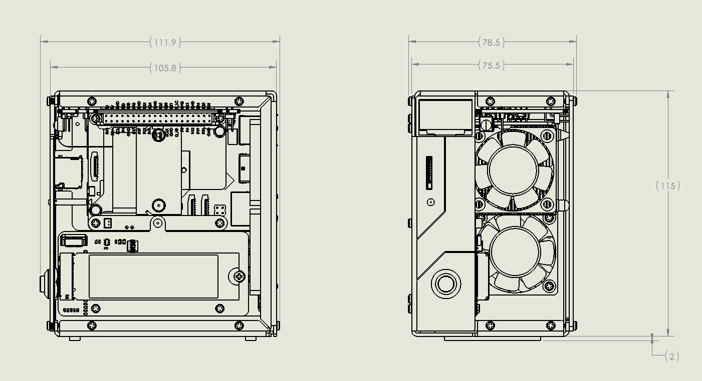

.. include:: /index.rst
   :start-after: start_hello_message
   :end-before: end_hello_message

特徴
======================

**仕様**

* 寸法: 111.9 x 78.5 x 117 mm
* 材質
    * 本体: アルミニウム合金
    * 両サイドパネル: アクリル
* 対応プラットフォーム: Raspberry Pi 5
* 電源入力: USB Type-C、5V/5A
* インターフェース
    * Raspberry Pi 標準 40ピン GPIO
    * スプリング式 Micro SD スロット
    * USB Type-C 電源入力
    * 2 x USB 2.0
    * 2 x USB 3.0
    * ギガビット LAN ポート
    * 2 x 4Kp60 HDMI Type A
* メタル製電源ボタン
* OLED スクリーン: 0.96インチ 128x64 解像度
* 1 x CPU ファン、2 x GPIO ファン: 40 x 40 x 10 mm
* 4 x WS2812-5050 RGB LED
* 38KHz IR レシーバー
* タワークーラー
* 2 x PCIe 2.0 x1 M.2 M key（2230、2242、2260、2280）、NVMe SSD または AI アクセラレータ用
* RTC 用 1220 バッテリー

**寸法図**

