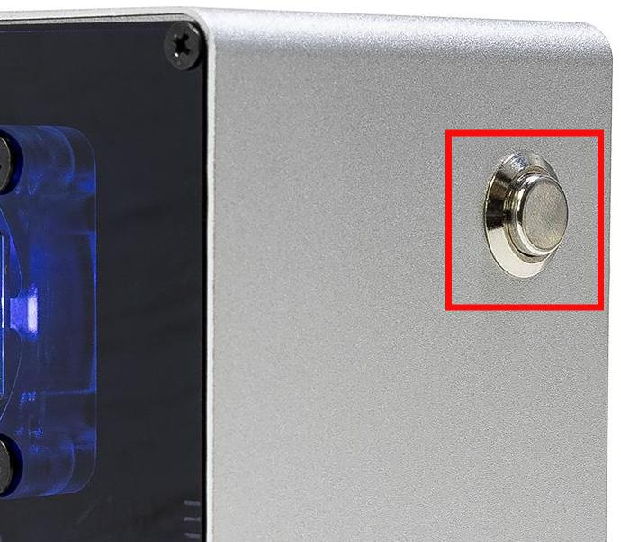
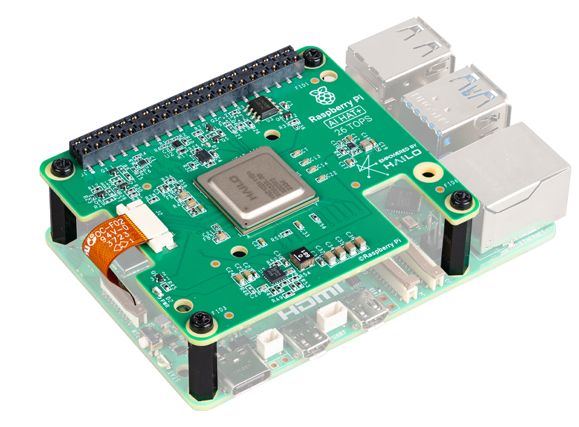
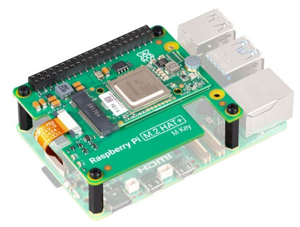
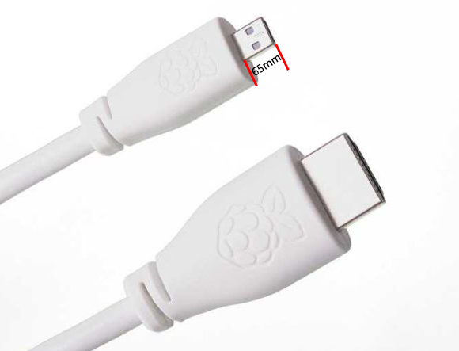

.. include:: /index.rst
   :start-after: start_hello_message
   :end-before: end_hello_message

FAQ
============

Schnelle Fehlerbehebung
-------------------------

* Einschalttaste funktioniert nicht → :ref:`faq_power_button_not_work_mini`
* RGB-LEDs funktionieren nicht → :ref:`faq_rgb_mini`
* CPU-Lüfter dreht sich nicht → :ref:`faq_pwm_fan_mini`
* Dashboard zeigt keine Daten an → :ref:`faq_dashboard_mini`
* PI5 startet nicht → :ref:`faq_pi5_boot_fail_mini`

1. Hardware
-------------

.. _com_os_mini:

Kompatible Systeme
^^^^^^^^^^^^^^^^^^^^

.. include:: ../pironman5/faq.rst
   :start-after: start_faq_com_os
   :end-before: end_faq_com_os

Power-Button
^^^^^^^^^^^^^^

Der Power-Button entspricht dem Ein-/Aus-Schalter des Raspberry Pi 5 und funktioniert genauso.

* **Herunterfahren**

  * Beim **Raspberry Pi OS Desktop** zweimal kurz drücken zum Herunterfahren.
  * Beim **Bookworm Lite** einmal drücken zum Herunterfahren.
  * Zum Erzwingen eines Hard-Shutdown: Taste gedrückt halten.

* **Einschalten**

  * Wenn der Raspberry Pi ausgeschaltet, aber mit Strom versorgt ist, genügt ein kurzer Tastendruck zum Einschalten.

* Bei Systemen ohne Softwareunterstützung für den Power-Button: Taste 5 Sekunden halten zum Ausschalten, danach kurzer Tastendruck zum Einschalten.

.. _faq_power_button_not_work_mini:

Power-Button funktioniert nicht?
^^^^^^^^^^^^^^^^^^^^^^^^^^^^^^^^^^

.. include:: ../pironman5/faq.rst
   :start-after: start_faq_power_button_not_work
   :end-before: end_faq_power_button_not_work

Raspberry Pi AI HAT+
^^^^^^^^^^^^^^^^^^^^^^

Das Raspberry Pi AI HAT+ ist nicht kompatibel mit dem Pironman 5.

Das Raspberry Pi AI Kit kombiniert das Raspberry Pi M.2 HAT+ mit dem Hailo AI-Beschleunigungsmodul.

Du kannst das Hailo AI-Modul aus dem Kit entfernen und direkt im HAT des Pironman 5 Mini verwenden.

Micro-HDMI-Kabel
^^^^^^^^^^^^^^^^^^

Wir empfehlen die Verwendung des offiziellen Raspberry Pi Micro-HDMI-Kabels. Bei einigen Kabeln von Drittanbietern mit einer Steckerlänge von weniger als 65 mm kann es zu schlechtem Kontakt und Anzeigeproblemen kommen.

2. Kühlung und Lüfter
-----------------------

.. _faq_pwm_fan_mini:

CPU-Lüfter funktioniert nicht?
^^^^^^^^^^^^^^^^^^^^^^^^^^^^^^^^

.. include:: ../pironman5/faq.rst
   :start-after: start_faq_pwm_fan
   :end-before: end_faq_pwm_fan

3. RGB
--------

.. |link_compatible_systems| replace:: :ref:`com_os_mini`

.. _faq_rgb_mini:

RGB-LEDs funktionieren nicht?
^^^^^^^^^^^^^^^^^^^^^^^^^^^^^^^

.. include:: ../pironman5/faq.rst
   :start-after: start_faq_rgb
   :end-before: end_faq_rgb

4. Dashboard und Software
---------------------------

.. _faq_dashboard_mini:

Dashboard zeigt keine Daten an
^^^^^^^^^^^^^^^^^^^^^^^^^^^^^^^^

.. include:: ../pironman5/faq.rst
   :start-after: start_faq_dashboard
   :end-before: end_faq_dashboard

.. |link_view_control_dashboard| replace:: :ref:`view_control_dashboard_mini`

Wie deaktiviere ich das Web-Dashboard?
^^^^^^^^^^^^^^^^^^^^^^^^^^^^^^^^^^^^^^^^

.. include:: ../pironman5/faq.rst
   :start-after: start_faq_disable_dashboard
   :end-before: end_faq_disable_dashboard

Wie deinstalliere und reinstalliere ich die Pironman 5 Software?
^^^^^^^^^^^^^^^^^^^^^^^^^^^^^^^^^^^^^^^^^^^^^^^^^^^^^^^^^^^^^^^^^^

.. include:: ../pironman5/faq.rst
   :start-after: start_faq_reinstall_pironman5
   :end-before: end_faq_reinstall_pironman5

.. |link_view_control_commands| replace:: :ref:`view_control_commands_mini`

Wie steuere ich Komponenten mit dem ``pironman5``-Befehl?
^^^^^^^^^^^^^^^^^^^^^^^^^^^^^^^^^^^^^^^^^^^^^^^^^^^^^^^^^^^

.. include:: ../pironman5/faq.rst
   :start-after: start_faq_pironman5_command
   :end-before: end_faq_pironman5_command

5. Boot und Speicher
----------------------

.. |link_update_bootloader| replace:: :ref:`update_bootloader_mini`

.. _faq_pi5_boot_fail_mini:

PI5 startet nicht (rote LED)?
^^^^^^^^^^^^^^^^^^^^^^^^^^^^^^^

Dieses Problem kann durch ein Systemupdate, Änderungen der Bootreihenfolge oder einen beschädigten Bootloader verursacht werden. Sie können die folgenden Schritte ausprobieren, um das Problem zu beheben:

#. Schließen Sie das Netzteil erneut an und überprüfen Sie, ob der PI5 erfolgreich startet.

#. Testen Sie den PI5 außerhalb des Gehäuses

   * Entnehmen Sie den PI5 aus dem Pironman 5 Mini-Gehäuse.
   * Versorgen Sie den PI5 direkt über das Netzteil (ohne Gehäuse).
   * Prüfen Sie, ob er normal startet.

#. Bootloader wiederherstellen

   * Wenn der PI5 immer noch nicht startet, ist möglicherweise der Bootloader beschädigt. Sie können dieser Anleitung folgen: |link_update_bootloader| und auswählen, ob Sie von SD-Karte oder NVMe/USB booten möchten.
   * Setzen Sie die vorbereitete SD-Karte in den PI5 ein, schalten Sie ihn ein und warten Sie mindestens 10 Sekunden. Sobald die Wiederherstellung abgeschlossen ist, entfernen und formatieren Sie die SD-Karte neu.
   * Verwenden Sie anschließend den Raspberry Pi Imager, um das neueste Raspberry Pi OS zu flashen, und versuchen Sie erneut zu booten.

.. |link_configure_boot_ssd| replace:: :ref:`configure_boot_ssd_mini`

Wie ändere ich die Boot-Reihenfolge des Raspberry Pi mit Befehlen?
^^^^^^^^^^^^^^^^^^^^^^^^^^^^^^^^^^^^^^^^^^^^^^^^^^^^^^^^^^^^^^^^^^^^

.. include:: ../pironman5/faq.rst
   :start-after: start_faq_boot_order_command
   :end-before: end_faq_boot_order_command

Wie ändere ich die Boot-Reihenfolge mit Raspberry Pi Imager?
^^^^^^^^^^^^^^^^^^^^^^^^^^^^^^^^^^^^^^^^^^^^^^^^^^^^^^^^^^^^^^

.. include:: ../pironman5/faq.rst
   :start-after: start_faq_boot_order_imager
   :end-before: end_faq_boot_order_imager

.. |link_copy_sd_to_nvme| replace:: :ref:`copy_sd_to_nvme_mini`

Wie kopiere ich das System von der SD-Karte auf eine NVMe-SSD?
^^^^^^^^^^^^^^^^^^^^^^^^^^^^^^^^^^^^^^^^^^^^^^^^^^^^^^^^^^^^^^^^

.. include:: ../pironman5/faq.rst
   :start-after: start_faq_copy_sd_to_nvme
   :end-before: end_faq_copy_sd_to_nvme

6. Erweiterte Nutzung
-----------------------

Wie entferne ich die Schutzfolie?
^^^^^^^^^^^^^^^^^^^^^^^^^^^^^^^^^^^

.. include:: ../pironman5/faq.rst
   :start-after: start_faq_remove_film
   :end-before: end_faq_remove_film

.. _openssh_powershell_mini:

Wie installiere ich OpenSSH über PowerShell?
^^^^^^^^^^^^^^^^^^^^^^^^^^^^^^^^^^^^^^^^^^^^^^

Wenn du den Befehl ``ssh <username>@<hostname>.local`` (oder ``ssh <username>@<IP address>``) ausführst und folgende Fehlermeldung erhältst:

.. code-block::

        ssh: The term 'ssh' is not recognized as the name of a cmdlet, function, script file, or operable program. Check the
        spelling of the name, or if a path was included, verify that the path is correct and try again.

Das bedeutet, dass dein Computersystem zu alt ist und `OpenSSH <https://learn.microsoft.com/en-us/windows-server/administration/openssh/openssh_install_firstuse?tabs=gui>`_ nicht vorinstalliert ist. Du musst der folgenden Anleitung folgen, um es manuell zu installieren.

#. Gib ``powershell`` in die Windows-Suchleiste ein, rechtsklicke auf ``Windows PowerShell`` und wähle ``Run as administrator``.

   .. image:: img/powershell_ssh.png
      :width: 90%

#. Installiere ``OpenSSH.Client`` mit folgendem Befehl:

   .. code-block::

        Add-WindowsCapability -Online -Name OpenSSH.Client~~~~0.0.1.0

#. Nach erfolgreicher Installation erscheint:

   .. code-block::

        Path          :
        Online        : True
        RestartNeeded : False

#. Überprüfe die Installation mit:

   .. code-block::

        Get-WindowsCapability -Online | Where-Object Name -like 'OpenSSH*'

#. Es wird nun angezeigt, dass ``OpenSSH.Client`` erfolgreich installiert wurde.

   .. code-block::

        Name  : OpenSSH.Client~~~~0.0.1.0
        State : Installed

        Name  : OpenSSH.Server~~~~0.0.1.0
        State : NotPresent

   .. warning::

        Wenn dies nicht erscheint, ist dein Windows zu alt. Verwende stattdessen ein Tool wie |link_putty|.

#. Starte PowerShell neu (wieder als Administrator) und verbinde dich dann mit dem ``ssh``-Befehl mit deinem Raspberry Pi. Du wirst zur Eingabe deines Passworts aufgefordert.

   .. image:: img/powershell_login.png
