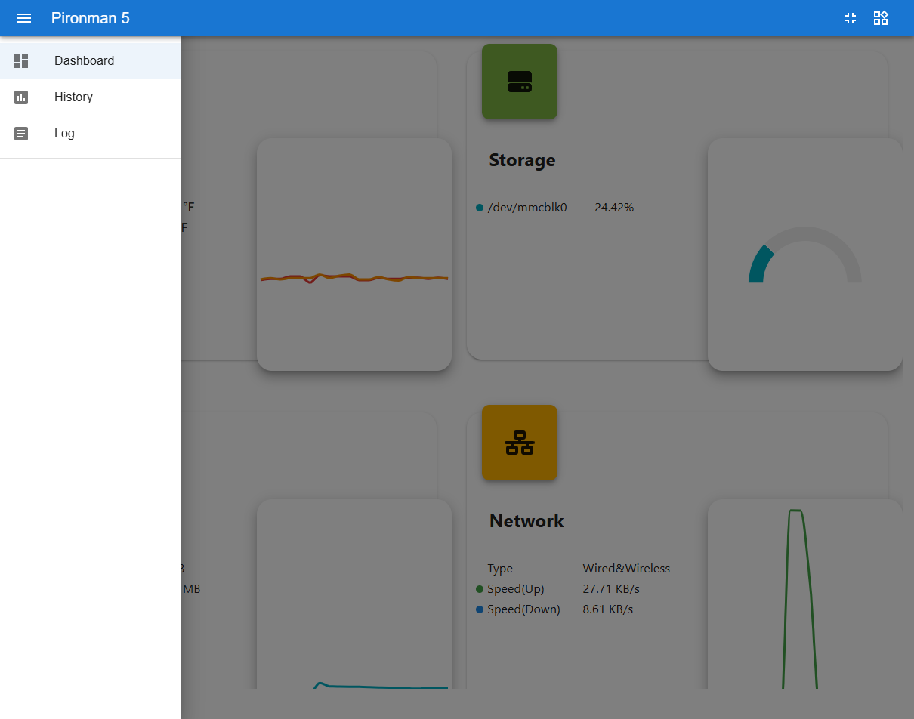
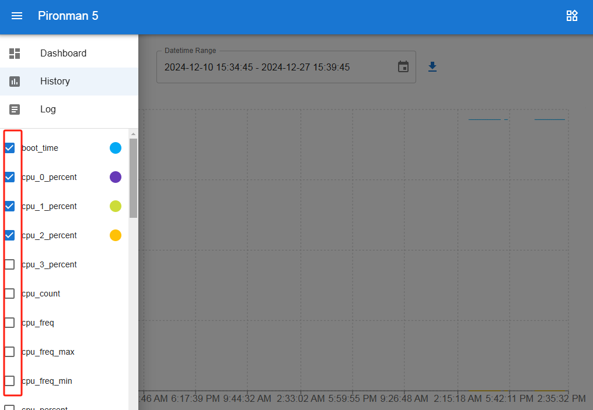
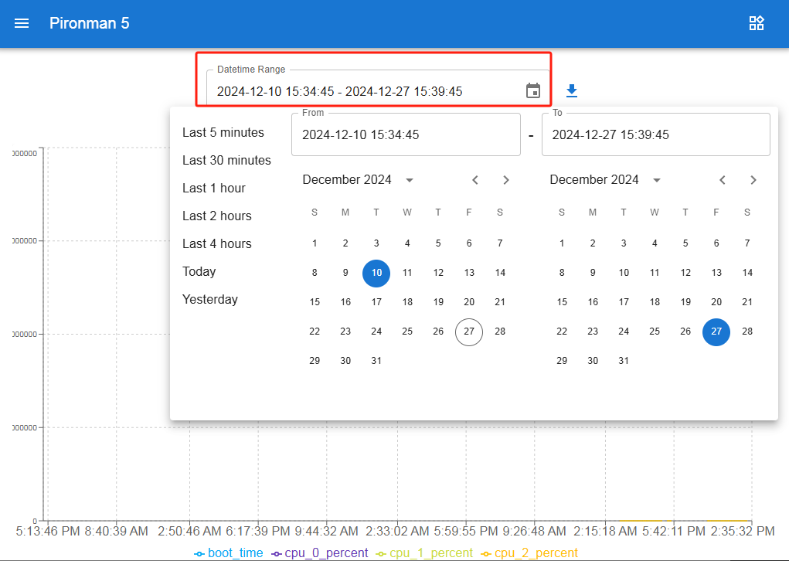
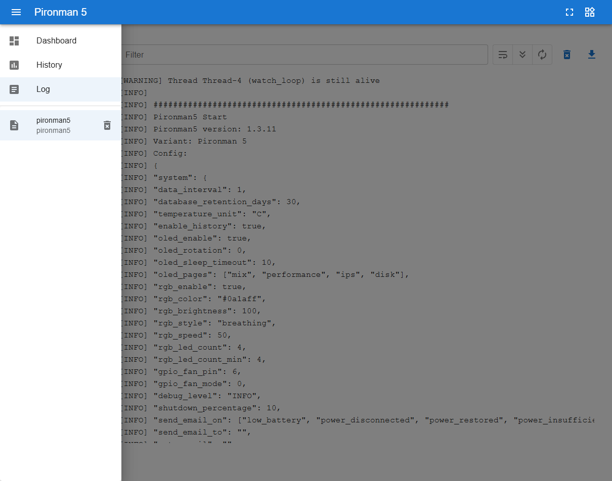
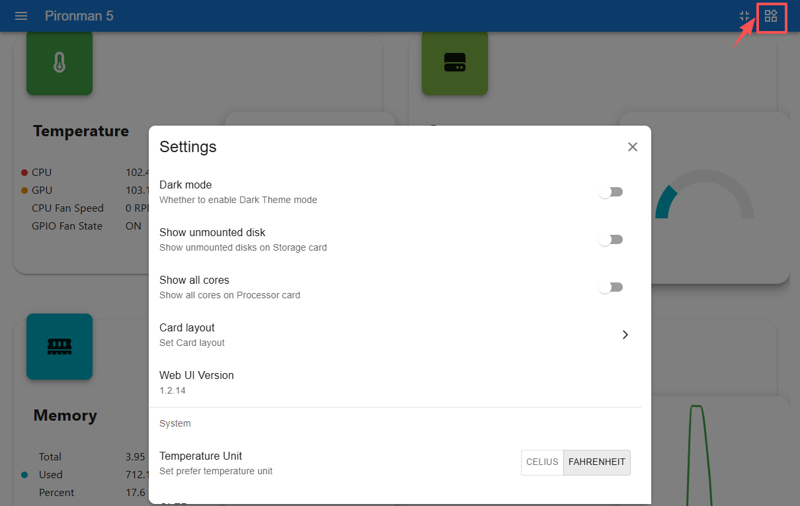

.. include:: /index.rst
   :start-after: start_hello_message
   :end-before: end_hello_message

.. _view_control_dashboard_ultra:

View and Control from Dashboard
=========================================

Once you have successfully installed the ``pironman5`` module, the ``pironman5.service`` will start automatically upon reboot.

Now you can open the monitoring page in your browser to see the information about your Raspberry Pi, configure the RGB lighting, and check the battery and power status. The page link is: ``http://<ip>:34001``.

This page has **Dashboard**, **History**, **Log**, and a **Settings** page.

Dashboard
-----------------------

There are multiple cards showing the current status of Pironman 5 Ultra and the Raspberry Pi:

* **Input**: shows the current external input status, including voltage, current, power, and whether the power supply is plugged in.

* **Temperature**: shows the current CPU and GPU temperature, and the speed of the Raspberry Pi PWM fan (if a Raspberry Pi PWM fan is connected).

  .. image:: img/dashboard_tem.png
    :width: 90%

* **Battery**: shows the current battery status, including the battery voltage, current, power, remaining percentage, and whether the battery is charging.

* **Raspberry Pi Power**: shows the current Raspberry Pi voltage, current, power, and the power source (``Battery`` or ``External``).

* **Storage**: displays the storage capacity of the Raspberry Pi, showing the various disk partitions with their used and available space.

  .. image:: img/dashboard_storage.png
    :width: 90%

* **Memory**: shows the Raspberry Pi RAM usage and percentage.

  .. image:: img/dashboard_memory.png
    :width: 90%

* **Network**: displays the current network connection type, and the upload and download speeds.

  .. image:: img/dashboard_network.png
    :width: 90%

* **Processor**: illustrates the Raspberry Pi CPU performance, including the status of its four cores, operating frequencies, and CPU usage percentage.

  .. image:: img/dashboard_processor.png
    :width: 90%

History
--------------

The History page allows you to view historical data. Check the data you want to view in the left sidebar, then select the time range to see the data for that period. You can also click to download it.

Log
------------

The Log page displays the runtime log of the ``pironman5`` service.

* Log entries can be filtered by level (Debug, Info, Warning, Error, or Critical).
* The log file can also be downloaded locally.

Settings
------------

The Settings page allows you to customize the Dashboard display, system preferences, the OLED screen, the RGB lighting, and the power behavior. It also shows basic network information such as the MAC address and IP address.

* **Interface**

  Configure the Dashboard appearance and display behavior.

  .. image:: img/dashboard_setting_interface.png
      :width: 600

  * **Dark mode**: enable or disable the dark theme.
  * **Show unmounted disk**: display unmounted storage devices on the Storage card.
  * **Show all cores**: display all CPU cores on the Processor card.
  * **Show battery warning**: always show a warning when the device is running on battery.
  * **Web UI version**: displays the current Dashboard version.

* **OLED**

  Configure the OLED screen display and behavior.

  .. image:: img/dashboard_setting_oled.png
      :width: 600

  * **OLED Enable**: enable or disable the OLED screen.
  * **OLED Rotation**: rotate the OLED display between ``0°`` and ``180°``.
  * **OLED Pages**: configure which pages are displayed on the OLED screen and adjust their display order.

    Available pages include:

    * **mix**: CPU usage, CPU temperature and IP address.
    * **performance**: CPU usage, CPU temperature, RAM usage and fan speed.
    * **ips**: IP addresses of all physical network interfaces.
    * **disk**: disk usage information for all disks.
    * **battery**: battery level and charging status.
    * **input**: external power input status.
    * **rpi_power**: Raspberry Pi voltage, current and power.

* **RGB**

  Configure the RGB light strip and the front RGB fan lighting.

  .. image:: img/dashboard_setting_rgb.png
      :width: 600

  * **RGB Enable**: enable or disable the RGB light strip and RGB fan lighting.
  * **Style**: select the lighting effect.
  * **Color**: set the RGB color.
  * **Color 2**: set the second RGB color.
  * **Brightness**: adjust the brightness.
  * **Speed**: adjust the animation speed.

* **Other Settings**

  Configure power behavior and view device information.

  .. image:: img/dashboard_setting_system.png
      :width: 600

  * **Buzzer (Buzz on)**: select which events trigger the buzzer.
  * **Buzzer Volume**: set the buzzer volume.
  * **Speaker Mode**: ``Auto`` (switches automatically) or ``ON`` (the speakers are always on).
  * **Shutdown Strategy**: the battery level at which the Raspberry Pi shuts down.
  * **Power Failure Simulation**: run a power failure test and generate a test report.
  * **Debug Level**: set the logging level of the service.
  * **Mac Address**: displays the MAC addresses of the Raspberry Pi network interfaces.
  * **IP Address**: displays the IP addresses of the Raspberry Pi network interfaces.
  * **History Retention**: set how many days historical data will be stored.
  * **Clear All Data**: clear all recorded history data.
  * **Restart Service**: restart the PiPower5 service.

Left Sidebar
------------------

* **History**: all historical data.
* **Log**: the service log.
