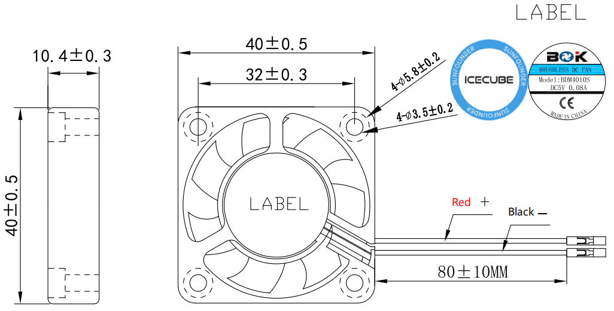

.. include:: /index.rst
   :start-after: start_hello_message
   :end-before: end_hello_message

.. _fan_ultra:

Fans
============

Pironman 5 Ultra has **three PWM fans**, all driven by the Raspberry Pi system:

* **CPU turbo fan**: works together with the aluminum heatsink (3010 blower fan) to cool the Raspberry Pi 5 core. No RGB.
* **Front RGB fan x2**: responsible for the whole-case airflow. Each fan has a built-in WS2812 RGB LED.

.. note::

   The fans only have a control signal and no tachometer (speed) signal, so the system cannot read the fan speed. This is normal and does not indicate a fault.

**Airflow**

The two front RGB fans draw cool air in through the front panel, and the warm air is exhausted through the top and rear vents. The CPU turbo fan pushes the heat away from the aluminum heatsink into the main airflow.

PWM Fan Gears
--------------------

The Raspberry Pi drives the PWM fans in one of several gears. The gear sets the CPU temperature at which the fans start:

.. list-table::
   :header-rows: 1
   :widths: 30 30

   * - Gear
     - Fans start at
   * - Quiet
     - 70°C
   * - Balanced
     - 67.5°C
   * - Cool
     - 60°C
   * - Performance
     - 50°C
   * - Always On
     - Always on

The lower the starting temperature, the earlier the fans spin up, so the system runs cooler but louder.

Front RGB Fan
-------------------

* **External dimension**: 40 x 40 x 10 mm
* **Rated Input power**: 5V / 0.1A
* **Rated Speed**: 3500 ± 10% RPM
* **Maximum Air Flow**: 2.46 CFM
* **Max. Air Pressure**: 0.62 mm-H2O
* **Acoustic Sound**: 22.31 dBA
* **Operating Temperature**: -10°C ~ +70°C
* **Storage Temperature**: -30°C ~ +85°C

The two front RGB fans are connected through the RGB module. Check that the adapter connector and the fan plug are firmly seated.

The RGB lighting of the front fans is controlled together with the top RGB light strip. See :ref:`rgb_module_ultra` for details.

CPU Turbo Fan
------------------

The CPU turbo fan is managed by the Raspberry Pi system. In the default gear its speed ramps as the temperature rises:

* **Below 50°C**: Fan remains off (0% speed).  
* **At 50°C**: Fan operates at low speed (30% speed).  
* **At 60°C**: Fan increases to medium speed (50% speed).  
* **At 67.5°C**: Fan ramps up to high speed (70% speed).  
* **At 75°C and above**: Fan operates at full speed (100% speed).  

This temperature-to-speed control includes a 5°C hysteresis to prevent frequent speed changes.

To check the fan's current state:

.. code-block:: shell

  cat /sys/class/thermal/cooling_device0/cur_state
