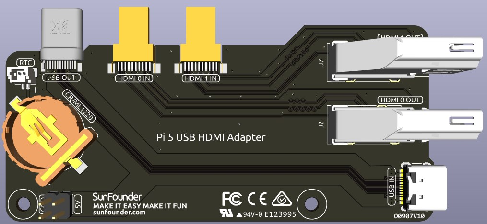

.. include:: /index.rst
   :start-after: start_hello_message
   :end-before: end_hello_message

HDMI Adapter Board
==========================================

The HDMI adapter board is located on the front of the case and integrates several functions:

* **HDMI splitter**: splits the audio signal out of the **HDMI0** signal.
* **Audio mode jumper**: selects ``Auto`` or ``ON``.

    * **Auto (default)**: combines the HDMI0 and headphone-insertion signals to control the amplifier automatically. When a monitor is plugged into HDMI0 or headphones are inserted, the amplifier is turned off and the audio is played through the external device.
    * **ON**: the amplifier is always on, and the speakers always output audio.

* **Audio amplifier**: drives the stereo speakers.
* **Stereo speakers**: 2030 4Ω 3W speakers, mounted on the adapter board.
* **3.5mm headphone jack**: connects external audio devices.
* **HDMI Type A ports**: convert the Raspberry Pi 5 Micro HDMI to standard HDMI Type A, for broader compatibility.
* **RTC battery holder**: for an RTC battery (compatible with CR1220 and ML1220).

The board routes the HDMI ports to the same side as the Raspberry Pi USB ports for convenient cable management. The audio is split from HDMI0 and the output mode is controlled intelligently by the jumper and detection circuit.

**1220 RTC Battery Holder**

A 1220 RTC battery holder is incorporated for convenient installation of an RTC battery. It connects to the Raspberry Pi's RTC interface via an SH1.0 2P reverse cable.

The battery holder is compatible with both CR1220 and ML1220 batteries. If using an ML1220 (Lithium Manganese Dioxide battery), charging can be configured directly on the Raspberry Pi. Note that the CR1220 is not rechargeable.

**Enabling Trickle Charging**

.. warning::

  If you're using a CR1220 battery, do not enable trickle charging as it can cause irreparable damage to the battery and risk damaging the board.

By default, the trickle charging feature for the battery is disabled. The ``sysfs`` files indicate the current trickle charging voltage and limits:

.. code-block:: shell

    pi@raspberrypi:~ $ cat /sys/devices/platform/soc/soc:rpi_rtc/rtc/rtc0/charging_voltage
    0
    pi@raspberrypi:~ $ cat /sys/devices/platform/soc/soc:rpi_rtc/rtc/rtc0/charging_voltage_max
    4400000
    pi@raspberrypi:~ $ cat /sys/devices/platform/soc/soc:rpi_rtc/rtc/rtc0/charging_voltage_min
    1300000

To enable trickle charging, add ``rtc_bbat_vchg`` to ``/boot/firmware/config.txt``:

  * Open ``/boot/firmware/config.txt``.
  
    .. code-block:: shell
    
      sudo nano /boot/firmware/config.txt
      
  * Add ``rtc_bbat_vchg`` to ``/boot/firmware/config.txt``.
  
    .. code-block:: shell
    
      dtparam=rtc_bbat_vchg=3000000
  
After rebooting, the system will display:

.. code-block:: shell

    pi@raspberrypi:~ $ cat /sys/devices/platform/soc/soc:rpi_rtc/rtc/rtc0/charging_voltage
    3000000

This confirms the battery is now under trickle charging. To disable this feature, simply remove the ``dtparam`` line from ``config.txt``.
