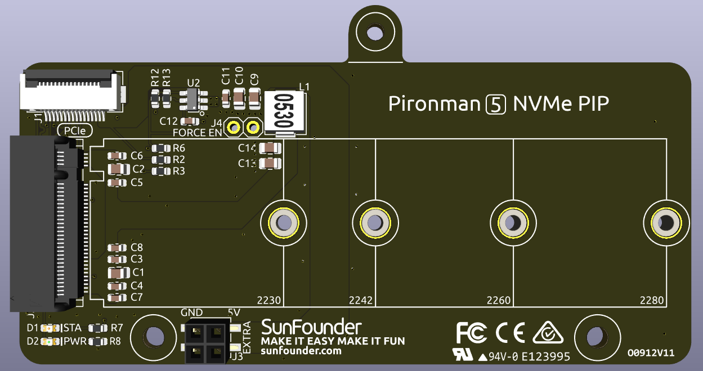
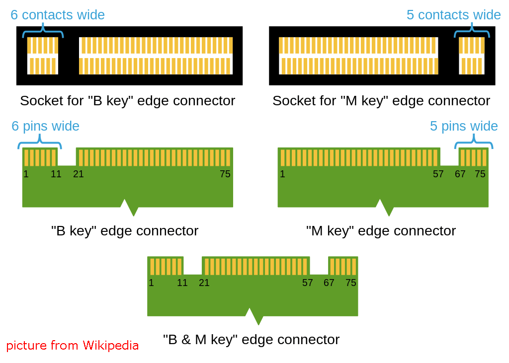
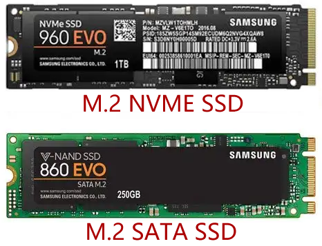
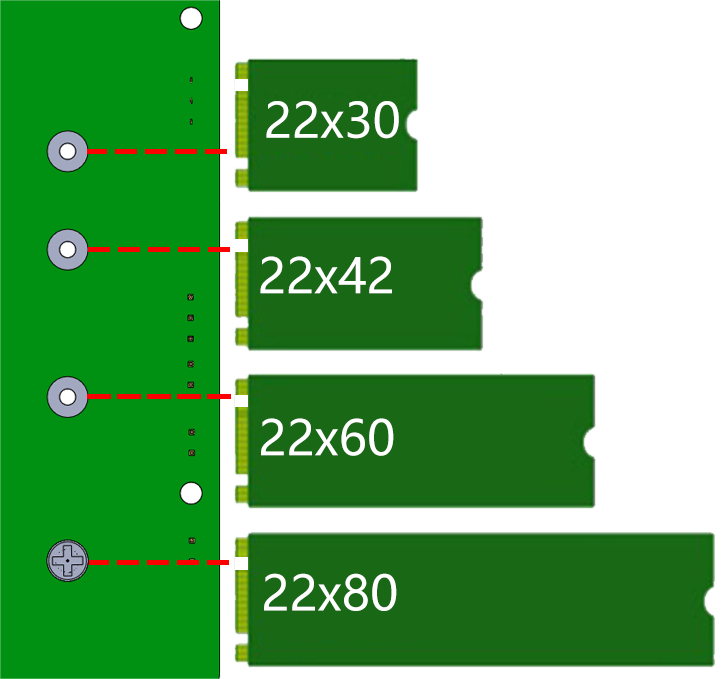

.. include:: /index.rst
   :start-after: start_hello_message
   :end-before: end_hello_message

.. _nvme_pip_ultra:

Dual NVMe PIP Expansion Module
==================================

The dual NVMe PIP expansion module provides NVMe storage expansion and PCIe external capability, and supports up to **2 PCIe devices**:

* **Interface 1 (fixed)**: M.2 M-key interface, supports 1 NVMe SSD (PCIe Gen 2 x1).
* **Interface 2 (either/or)**: the Raspberry Pi 5 standard PCIe interface **or** an M.2 M-key interface.

    * **M.2**: supports 1 NVMe SSD (PCIe Gen 2 x1).
    * **Raspberry Pi standard PCIe**: comes with an external ribbon cable, and can connect other PCIe HATs such as the AI HAT+ and AI HAT+ 2.

The two options are selected by an onboard switch chip (MUX), which is switched automatically by the Raspberry Pi **PCIe DET** pin.

* The board connects to the Raspberry Pi 5 PCIe interface through a PCIe ribbon cable.
* **STA**: a Status LED indicator.
* **PWR**: a Power LED indicator.

PCIe Channel Structure
--------------------------

.. code-block:: text

   Pi 5 PCIe (Gen2 x1)
     └─ ASM1182e 2-Port PCIe Gen2 Switch
          ├─ Port 1 → M.2 slot 1 (NVMe SSD 1)
          └─ Port 2 → Switch chip (MUX)
               ├─ Output A → M.2 slot 2 (NVMe SSD 2)
               └─ Output B → Raspberry Pi standard PCIe interface

Interface Switching
-----------------------

.. list-table::
   :header-rows: 1
   :widths: 40 60

   * - Scenario
     - Switching method
   * - A Raspberry Pi standard PCIe HAT is connected (such as the AI HAT+ / AI HAT+ 2)
     - **Automatic**: the Raspberry Pi PCIe DET pin detects a high level and forces the switch to the PCIe interface.
   * - No PCIe HAT is connected
     - **Automatic**: DET is low, so it defaults to the M.2 interface.
   * - A non-Raspberry-Pi-standard PCIe device is used (no DET high-level signal)
     - **Manual**: disconnect the onboard DET detection pad jumper, and use the 3P pad jumper to select the PCIe or M.2 interface manually.

Optional Combinations
-------------------------

.. list-table::
   :header-rows: 1
   :widths: 25 60

   * - Combination
     - Description
   * - Dual M.2 (default)
     - Interface 1 M.2 + Interface 2 M.2 (two NVMe SSDs, MUX defaults to M.2).
   * - M.2 + PCIe HAT
     - Interface 1 M.2 + Interface 2 Raspberry Pi standard PCIe HAT (switched automatically by DET when connected).

When using a PCIe HAT, make sure the ribbon cable is connected correctly and configure the Raspberry Pi PCIe parameters according to the requirements of the HAT.

About the Model
---------------------------

M.2 SSDs come in various types, mainly differentiated by their keying (the notch design on the connector) and the interface they use:

* **M.2 SATA SSDs**: these use the SATA interface, similar to 2.5-inch SATA SSDs but in the smaller M.2 form factor. They are limited by the SATA III maximum speed of around 600 MB/s. These SSDs are compatible with M.2 slots keyed for B and M keys.
* **M.2 NVMe SSDs**: these use the NVMe protocol over PCIe lanes and are significantly faster than M.2 SATA SSDs. They are suitable for applications requiring high read/write speeds. These drives typically require M-keyed slots.

In general, M.2 SATA SSDs are B+M-keyed (they can fit in sockets for B-keyed and M-keyed modules), while M.2 NVMe SSDs for PCIe are M-keyed.

About the Length
-----------------------

Pironman 5 Ultra supports four (PCIe Gen 2.0 / PCIe Gen 3.0) NVMe M.2 SSD sizes: 2230, 2242, 2260, and 2280. The "22" is the width in millimeters, and the two following numbers are the length.

