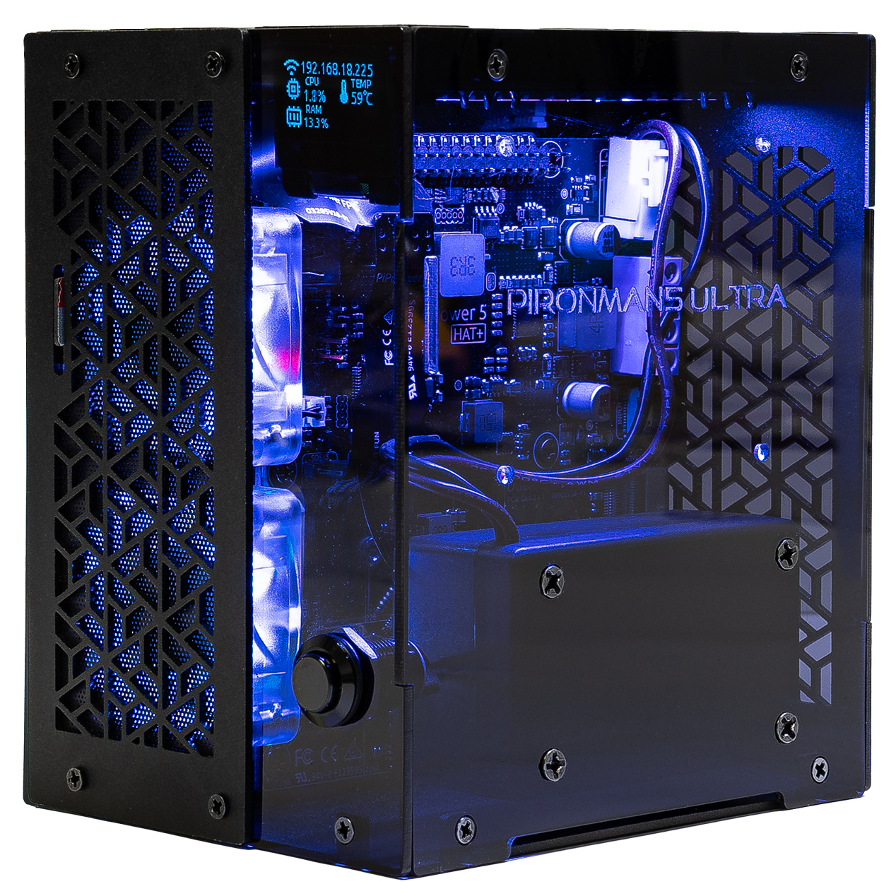
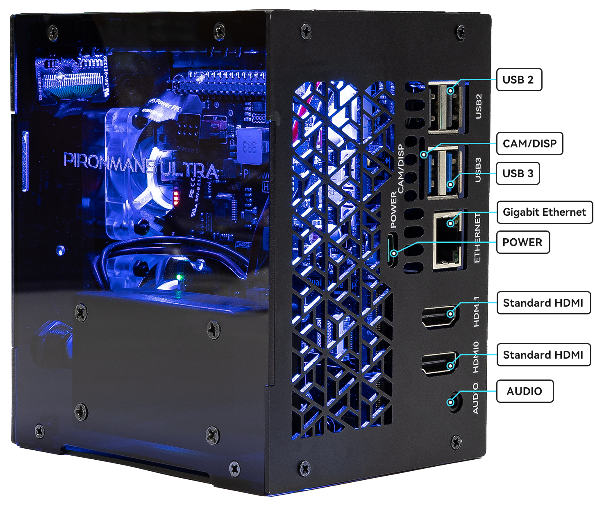
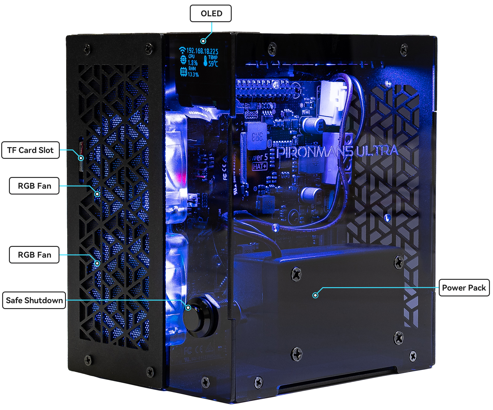

.. include:: /index.rst
   :start-after: start_hello_message
   :end-before: end_hello_message

.. _intro_pironman5_ultra:

Pironman 5 Ultra
=================================================================================

Thanks for choosing our |link_pironman5_ultra|.

Pironman 5 Ultra is the newest member of the Pironman case family, designed exclusively for the Raspberry Pi 5. It integrates the **PiPower 5 module** and uninterruptible power supply (UPS) functionality, protecting your device against unstable external power and unexpected power loss.

It has a built-in **7.4V 2000mAh Power Pack (SFB20003C2S)** battery, supporting up to **5V/5A** output and **20W** charging. It also integrates a **CPU aluminum heatsink with a turbo fan**, **2 front RGB fans**, an **OLED screen**, an **RGB light strip**, dual **PCIe Gen 2 x1 M.2 M-key** interfaces plus the Raspberry Pi 5 standard PCIe expansion interface, so you can add NVMe SSDs or AI accelerators such as the **AI HAT+** and **AI HAT+ 2**. In addition, built-in stereo speakers and a headphone jack provide convenient audio output.

**Key Features**

* **Power Input**: 5-15V, 45W Max, USB Type-C PD or screw terminal
* **PCIe**: Dual M.2 M-key (PCIe Gen 2 x1) + Raspberry Pi 5 standard PCIe interface
* **Power for Raspberry Pi**: 5V/5A
* **Charge Power**: 5 / 10 / 15 / 20W optional
* **USB**: 2 x USB 3.0, 2 x USB 2.0 (from the Raspberry Pi)
* **Video**: Dual 4Kp60 HDMI Type A display output (from the Raspberry Pi)
* **Audio**: Built-in stereo speakers + 3.5mm headphone jack
* **Display**: 0.96'' 128x64 OLED display
* **Heat Dissipation**: CPU aluminum heatsink + turbo fan + 2 x front RGB fans
* **RGB**: Top RGB light strip + 2 x front RGB fan lighting
* **Battery**: 7.4V 2000mAh Power Pack (SFB20003C2S), 2-cell Li-ion, VH3.96-2P
* **Other**: Default On jumper cap, power switch, RTC 1220 battery holder, Raspberry Pi 40-pin GPIO

.. note::

   Pironman 5 Ultra uses the **PiPower 5** module and requires a **64-bit operating system**, such as Raspberry Pi OS 64-bit or Ubuntu 64-bit. **32-bit systems are not supported.**

.. note::

   It is recommended to use a 45W or higher USB Type-C PD power supply together with Pironman 5 Ultra. When using the official 27W power supply, the Raspberry Pi can still be powered at up to 5V/5A, but the charging power is limited to 5W.

.. toctree::
    :maxdepth: 1

    About this Kit <self>
    what_do_we_need    
    assembly_instructions
    install/install_the_os
    set_up/set_up_pironman5
    control/control_pironman5
    hardware/hardware
    optional_modules/optional_modules
    home_server/home_server
    compitable_nvme_ssd
    faq

**Interfaces**

**Rear I/O**

**Side and Internal Layout**

**Product Specification**

:download:`[PDF] Pironman 5 Ultra Product Specification <Pironman5Ultra.pdf>`
