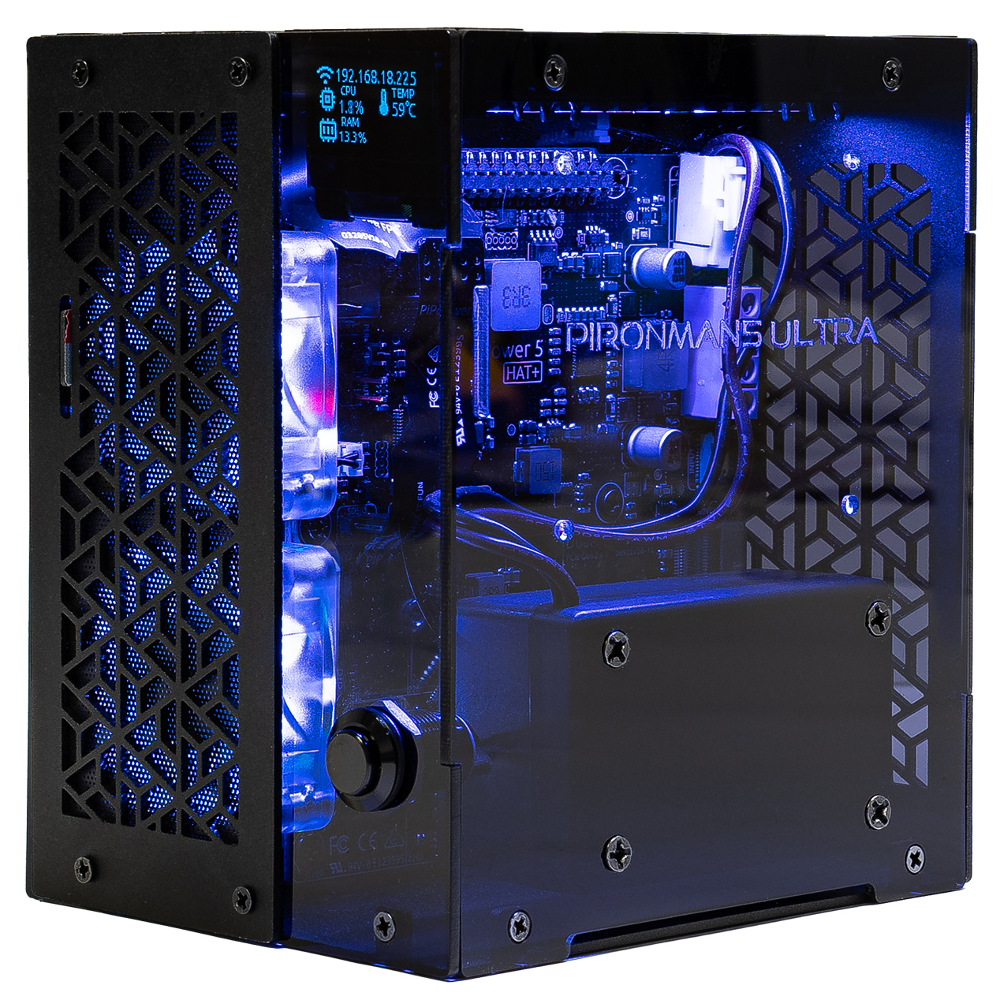

.. include:: /index.rst
   :start-after: start_hello_message
   :end-before: end_hello_message

Setting Up on Raspberry Pi OS/Ubuntu/Kali Linux
==================================================================

If you have installed Raspberry Pi OS, Ubuntu or Kali Linux on your Raspberry Pi, you will need to configure Pironman 5 Ultra using the command line.

.. note::

  Pironman 5 Ultra and the PiPower 5 module only support **64-bit operating systems** (for example Raspberry Pi OS 64-bit or Ubuntu 64-bit). **32-bit systems are not supported.**

.. note::

  Before configuring, you need to boot up and log into your Raspberry Pi. If you're unsure how to log in, you can visit the official Raspberry Pi website: |link_rpi_get_start|.

.. _safe_shutdown_ultra:

1. Configuring Power-Off After Raspberry Pi Shutdown
------------------------------------------------------------

PiPower 5 relies on the Raspberry Pi shutdown state to control the power output. To let PiPower 5 cut the power automatically after the Raspberry Pi shuts down, some additional configuration is required.

#. Make sure the ``SDSIG`` jumper on the PiPower 5 module is connected to ``PI3V3``.

#. Open the Raspberry Pi configuration tool:

   .. code-block:: shell

      sudo raspi-config

#. Navigate to **Advanced Options → Shutdown Behaviour**.

   .. image:: img/shutdown_behaviour.png

#. Select **Full Power Off...**.

   .. image:: img/run_power_off.png

#. Save the changes. You will be prompted to reboot for the new settings to take effect.

.. _install_pironman5_module_ultra:

2. Installing the ``pironman5`` Module
-----------------------------------------------------------

#. Download and install the ``pironman5`` module from GitHub.

   .. code-block:: shell

      curl -sSL "https://raw.githubusercontent.com/sunfounder/pironman5/v1/install.sh" | sudo bash

   .. note::

      1. If you are using **Ubuntu**, install ``curl`` first: ``sudo apt install curl -y``

      2. **PiPower 5 is installed automatically** for Pironman 5 Ultra. There is no separate ``--pipower5`` step.

#. After running the installer, select your Pironman 5 model.

   .. code-block:: shell

      Pironman 5 Installer v1.0.1
      Supports: 5 | 5 Mini | 5 Max | 5 Pro Max | 5 Ultra

      Please select your product model:
      1) Pironman 5
      2) Pironman 5 Mini
      3) Pironman 5 Max
      4) Pironman 5 Pro Max
      5) Pironman 5 Ultra

      Enter number [1-5]:

   You can also skip the menu and specify the model directly:

   .. code-block:: shell

      curl -sSL "https://raw.githubusercontent.com/sunfounder/pironman5/v1/install.sh" | sudo bash -s -- --variant ultra

#. Once the installation is complete, reboot the Raspberry Pi as prompted. The first startup may take up to 30 seconds while the services initialize.

#. After Pironman 5 Ultra starts successfully, check whether the following components are working properly.

   * **OLED Screen**

     * Displays CPU usage, RAM usage, CPU temperature, battery status and IP address.
     * Turns off automatically after 10 seconds.
     * Briefly press the power button to wake the screen or switch pages.

   * **Power Button (PiPower 5)**

     * Briefly press: Power on / wake up OLED / switch OLED page.
     * Hold for 2 seconds: Safe shutdown (requires :ref:`safe_shutdown_ultra`).
     * Hold for 5 seconds: Force shutdown.

   * **RGB Light Strip and Front RGB Fans**

     * Light up with a breathing effect.

   * **CPU Turbo Fan and Front Fans**

     * Follow the standard Raspberry Pi 5 temperature curve and turn on above 50°C.
     * The fan speed cannot be read back, because the fans have no tachometer signal.

   * **Battery and Charging**

     * Check the battery status on the Dashboard or with ``pipower5 -a``.
     * A battery icon appears in the desktop status bar.

#. Use ``systemctl`` to manage the ``pironman5.service``.

   .. code-block:: shell

      sudo systemctl restart pironman5.service

   Replace ``restart`` with ``start``, ``stop``, or ``status`` as needed to manage the service.

.. note::

   Pironman 5 Ultra is now ready to use.

   For advanced controls and dashboard features, see :ref:`control_commands_dashboard_ultra`.
